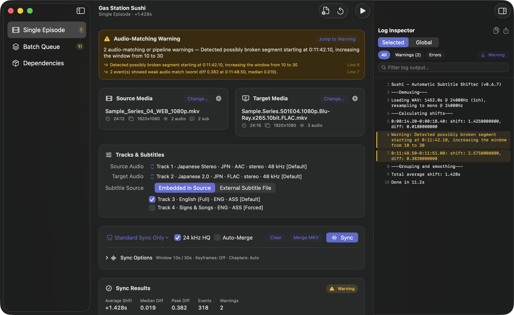
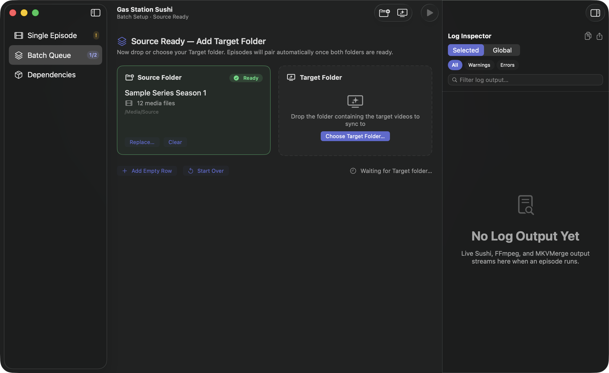
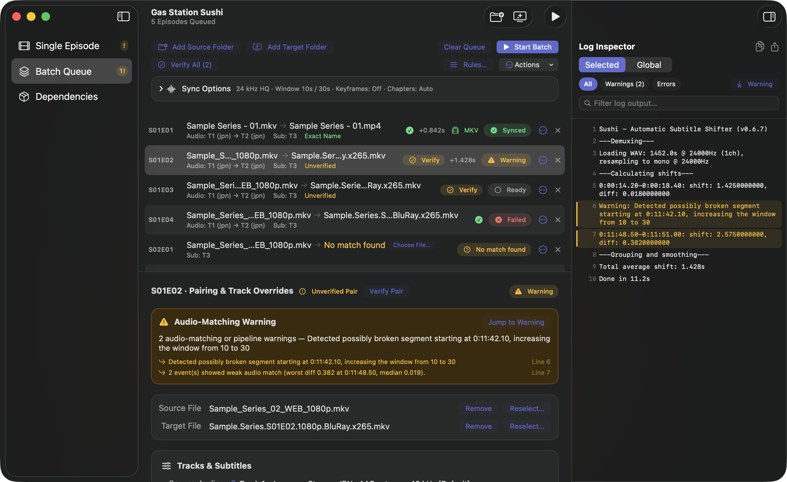
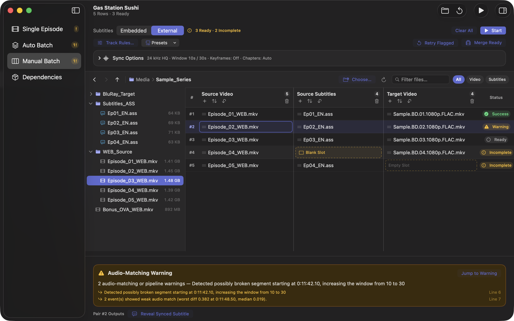
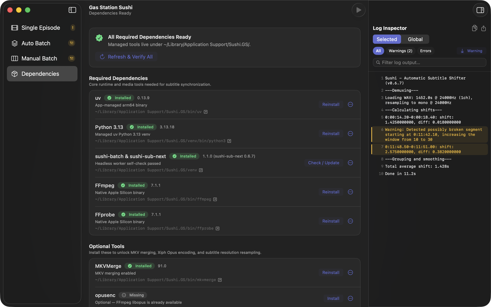

# <p align="center"> Sushi.GS aka Gas Station Sushi

<p align="center">
  
</p>

<p align="center">
  <a href="https://github.com/MobiusGT/Sushi.GS/releases">
    
  </a>
  
  
</p>

**Sushi.GS ("Gas Station Sushi")** is a native Apple Silicon (`arm64`) **macOS GUI** for **Sushi subtitle retiming**, built in SwiftUI around **[`C1fer/sushi-batch`](https://github.com/C1fer/sushi-batch)** and **[`C1fer/sushi-next`](https://github.com/C1fer/sushi-next)** (`sushi-sub-next`). It automates **audio-based ASS, SRT, and SSA subtitle synchronization**—ideal for syncing WEB-DL or fansub subtitles to Blu-ray (BD Remux) releases without breaking ASS typesetting—across **Single Episode**, **Auto Batch**, and **Manual Batch** workflows with built-in **MKV muxing**. Install in seconds via the ready-to-run **`.dmg` download** from [GitHub Releases](https://github.com/MobiusGT/Sushi.GS/releases) and provision every runtime dependency inside the app with zero Terminal setup.

---

## Screenshots

<table>
  <tr>
    <td width="50%" valign="top" align="center">
      
      <br>
      <strong>Single Episode &amp; Live Log Inspector</strong><br>
    </td>
    <td width="50%" valign="top" align="center">
      
      <br>
      <strong>Auto Batch Intake (Embedded &amp; External)</strong><br>
    </td>
  </tr>
  <tr>
    <td width="50%" valign="top" align="center">
      
      <br>
      <strong>Auto Batch Queue</strong><br>
    </td>
    <td width="50%" valign="top" align="center">
      
      <br>
      <strong>Manual Batch (Native File Browser &amp; Columns)</strong><br>
    </td>
  </tr>
  <tr>
    <td colspan="2" valign="top" align="center">
      
      <br>
      <strong>In-App Dependency Manager</strong><br>
    </td>
  </tr>
</table>

---

## Features

- **Single Episode, Auto Batch & Manual Batch Workspaces**
  - **Single Episode (`⌘1`):** Drag-and-drop Source media, Target media, and optional external `.ass`/`.srt`/`.ssa`/`.sub`/`.vtt` subtitles (or pick embedded subtitle tracks directly from the Source file), with a one-click **Clear** reset (`⇧⌘K`) to return to a clean slate.
  - **Auto Batch (`⌘2`):** Toggle between **Embedded** (2-folder intake: **Source Media Folder** + **Target Media Folder**) and **External** (3-folder intake adding **Subtitle Folder** for `.ass`/`.srt`/`.ssa`/`.sub`/`.vtt` files, including nested subfolders), or click **Continue to Queue** anytime to enter Stage 2 with partial folders (or a blank row). Add folders anytime via **Add Source Media Folder** (`⌥⌘O`), **Add Target Media Folder** (`⌥⇧⌘O`), and **Add External Subtitle Folder** (`⌃⌥⌘O`).
  - **Manual Batch (`⌘3`):** Pure row-by-row manual pairing with zero regex or filename auto-matching. Features an inverted-L (`Γ`) native **File Browser** (Back/Forward/Up navigation, clickable breadcrumbs, natural Finder sorting, search, `All`/`Video`/`Subtitles` filter pills, and type-locked multi-select drag-and-drop) paired with smoothly resizable, scroll-synchronized **Source Video**, optional **Source Subtitles** (`External` mode), and **Target Video** columns with `#1`…`#N` row banding, independent drag reordering, **Insert Blank Slot** alignment, **Sort A–Z**, **Reverse**, and **Clear Column**.
- **Smart Multi-Tier Auto Batch Pairing & Verification**
  - **Strict Season Safety:** Differing explicit seasons (`S01E05` vs `S02E05`, `Season 1` vs `Season 2`, `1x05` vs `2x05`) never cross-match across media or external subtitles.
  - **Auto-Verified Exact Matches:** Exact filenames or identical filename stems across different containers (and matching external subtitle stems in External mode) auto-verify immediately; heuristic matches on Target or Subtitle start as **Unverified** for quick confirmation.
  - **BDMV & Fansub Episode Cascade:** Strips release-group brackets (`[Moozzi2]`, `[Stardust]`) and media noise (`1080p`, `x265`, `10bit`, `BD Remux`, `FLAC2.0`, `[DEADBEEF]`, years), normalizes `S##E##`, arbitrarily zero-padded BDMV numbers (`00001` → `1`), version tags (`01v2` → `1`), and fractional specials (`01.5` → `1.5`), isolates numbered extras (`OVA`, `Menu`, `PV`, `CM`, `NCOP`/`NCED`), and leaves genuinely unmatched files clearly labeled **"No match found"** with contextual **Choose File…** pickers.
- **Explicit Track Matching & Full Sushi Controls**
  - Inspects media via `ffprobe` (and `mkvmerge -J` for MKVs) to match any Source audio track against any Target audio track and select one or more embedded or external subtitles.
  - Exposes high-value Sushi parameters inline (**24 kHz HQ**, **Window**, **Max Window**, **Keyframe Snapping**, **Chapters**) and full defaults in **Settings → Sync / Merge / Audio**, with concise hover-only descriptions to keep the workspace uncluttered.
  - Supports automatic or manual **MKVMerge** muxing, pre-merge lossless audio re-encoding (**Opus**, **AAC**, **EAC-3**), optional **Aegisub-CLI** subtitle resolution resampling, batch track rules, and reusable presets across both Auto Batch and Manual Batch.
- **Live Log Inspector & Automatic Audio-Matching Warnings**
  - Collapsible real-time streaming Log Inspector (`⌃⌘I`, collapsed by default) with search, `All` / `Warnings` / `Errors` filtering, copy, and `.log` export.
  - Automatically flags max-window fallbacks, broken segments, high audio diff scores, sudden shift jumps, large average shifts, chapter/keyframe inconsistencies, and pipeline warnings with a prominent warning banner and one-click **Jump to Warning**.
- **Zero-Terminal In-App Dependency Manager (`⌘4`)**
  - Installs and updates `uv`, managed Python 3.13, `sushi-batch` (+ `sushi-sub-next`), and standalone Apple Silicon `ffmpeg`/`ffprobe` directly inside `~/Library/Application Support/Sushi.GS/`, plus optional `mkvmerge`, `opusenc`, and guided `aegisub-cli` setup.

---

## How Sushi.GS Compares

| Tool | macOS Apple Silicon | Native GUI | Batch Modes | Setup |
| :--- | :--- | :--- | :--- | :--- |
| **Sushi.GS** | Yes (`arm64`, macOS 26+) | Native macOS SwiftUI | Single Episode, Auto Batch (2- & 3-way), Manual Batch | `.dmg` + 1-click in-app installer (`uv`, `sushi-batch`, `ffmpeg`, `mkvmerge`) |
| **[`C1fer/sushi-batch`](https://github.com/C1fer/sushi-batch)** | Via Python 3.13+ | Cross-platform PyQt / CLI | Folder auto-batch + MKV merge & audio encode | Manual Python / `uv` + FFmpeg / MKVToolNix setup |
| **`SubtitleSynchroLauncher`** | No (Windows only) | Windows GUI | Batch launcher wrapper | Windows binary + manual tool paths |
| **[`tp7/Sushi`](https://github.com/tp7/Sushi)** | Legacy (unmaintained Python) | CLI only | Single-file CLI (manual scripting) | Manual Python / OpenCV / FFmpeg setup |
| **`Sushi.Net`** | Via .NET runtime / build | CLI only | Single-file CLI (manual scripting) | Manual .NET + FFmpeg / MKVToolNix setup |

---

## Installation

Requires an **Apple Silicon Mac running macOS 26+**.

1. Download **`Sushi.GS-0.1.1-arm64.dmg`** (and optionally verify its checksum with `shasum -a 256 -c Sushi.GS-0.1.1-arm64.dmg.sha256`) from [GitHub Releases](https://github.com/MobiusGT/Sushi.GS/releases).
2. Open **`Sushi.GS-0.1.1-arm64.dmg`** and drag **`Sushi.GS.app`** into **`Applications`**.
3. Launch **`Sushi.GS`** from `/Applications`, Spotlight, or the Apps drawer (its window title bar displays **Gas Station Sushi**).
4. On first launch, click **Install Required Dependencies** in the **Dependencies** view to provision `uv`, Python 3.13, `sushi-batch`, `ffmpeg`, and `ffprobe` automatically.

### Opening Ad-Hoc Signed Builds on macOS Gatekeeper

GitHub Release builds without a paid Apple Developer ID certificate are ad-hoc signed. If macOS displays an *"Apple could not verify Sushi.GS is free of malware"* warning on first launch:

- **Option 1 (System Settings):** Try to open `Sushi.GS.app`, then open **System Settings → Privacy & Security**, scroll to **Security**, and click **Open Anyway**.
- **Option 2 (Terminal):** Clear the download quarantine attribute once:
  ```bash
  xattr -cr /Applications/Sushi.GS.app
  ```

---

## FAQ

### Is there a native Mac GUI for Sushi subtitle retiming?
Yes. **Sushi.GS** ("Gas Station Sushi") is a native Apple Silicon SwiftUI macOS app that wraps [`C1fer/sushi-batch`](https://github.com/C1fer/sushi-batch) and [`C1fer/sushi-next`](https://github.com/C1fer/sushi-next) (`sushi-sub-next`). It replaces CLI invocations with drag-and-drop **Single Episode**, **Auto Batch**, and **Manual Batch** workspaces, explicit audio/subtitle track pickers, inline Sushi sync flags, and a live Log Inspector.

### How do I sync WEB-DL or fansub ASS subtitles to Blu-ray (BD Remux) MKVs on macOS without breaking typesetting?
Add your WEB-DL (Source) files, Blu-ray / BD Remux (Target) files, and optional external `.ass`/`.srt`/`.ssa` subtitles into **Single Episode**, **Auto Batch**, or **Manual Batch**, pick the matching audio track on each side (for example, Japanese `jpn`), and click **Run Sync**. Sushi shifts each dialogue and typesetting event individually by matching the Source and Target audio streams—preserving ASS styling, signs, karaoke, and animations—and can optionally resample subtitle resolution with `aegisub-cli` and mux everything (including Source fonts/attachments) into a clean MKV via `mkvmerge`.

### Does Sushi.GS require Terminal commands or manual Homebrew/Python installation?
No. After dragging `Sushi.GS.app` from `Sushi.GS-0.1.1-arm64.dmg` into `/Applications`, open **Dependencies (`⌘4`)** and click **Install Required Dependencies**. Sushi.GS automatically downloads and manages `uv`, Python 3.13, `sushi-batch` + `sushi-sub-next`, standalone Apple Silicon `ffmpeg`/`ffprobe`, and optional `mkvmerge` and `opusenc` inside `~/Library/Application Support/Sushi.GS/` without modifying system Python.

### How does Sushi dual-audio matching differ from `ffsubsync` or `alass`?
`ffsubsync` and `alass` rely on Voice Activity Detection (VAD) or a second reference subtitle track to align speech timings, which works well for uniform offsets but can drift across anime scene cuts, commercial breaks, differing openings/endings, or non-dialogue ASS typesetting. **Sushi** compares the actual audio waveforms of a Source video (already timed to your subtitles) directly against the Target video (such as a Blu-ray remux), producing per-segment, keyframe-snapped shifts that stay accurate across edits while keeping ASS typesetting intact.

---

## Architecture & Upstream Updateability

`Sushi.GS` intentionally does **not** fork or vendor `sushi-batch` or `sushi-next` internals:
- The SwiftUI frontend bundles only a thin headless Python bridge (`Contents/Resources/worker.py`).
- All mutable runtime state (`uv`, Python 3.13, the `sushi-batch` virtual environment, downloaded binaries, presets, and logs) is stored strictly in `~/Library/Application Support/Sushi.GS/`.
- Updating to new upstream `C1fer/sushi-batch` releases is one click inside **Dependencies**, verified by an automatic headless compatibility self-check.
- No third-party GPL/LGPL binaries (`ffmpeg`, `mkvmerge`, etc.) are bundled inside the `.dmg`.

---

## Building from Source

Requires an Apple Silicon Mac running **macOS 26+** with **Xcode 26/27+** (Swift 6.2+ toolchain).

```bash
git clone https://github.com/MobiusGT/Sushi.GS.git
cd Sushi.GS

# Run Swift Testing unit tests
swift test

# Build Release arm64 app bundle into ~/Applications/Sushi.GS.app
./build.sh --open

# Package dist/Sushi.GS-0.1.1-arm64.dmg + .sha256
scripts/build_dmg.sh
```

### Optional Developer ID Signing & Notarization

`scripts/build_dmg.sh` defaults to ad-hoc signing (`-`). To sign and notarize a release `.dmg` with your Apple Developer account:

```bash
CODESIGN_IDENTITY="Developer ID Application: Your Name (TEAMID)" \
NOTARY_PROFILE="your-notarytool-profile" \
scripts/build_dmg.sh
```

*(Alternatively, supply `APPLE_ID`, `APPLE_TEAM_ID`, and `APPLE_APP_SPECIFIC_PASSWORD` instead of `NOTARY_PROFILE`.)*

---

## Credits

`Sushi.GS` ("Gas Station Sushi") is a macOS frontend built on the work of the Sushi subtitle-synchronization ecosystem:

- **[`C1fer/sushi-batch`](https://github.com/C1fer/sushi-batch)** — Batch subtitle synchronization, MKVMerge, lossless audio re-encoding, and subtitle resampling pipeline wrapped by Sushi.GS.
- **[`C1fer/sushi-next`](https://github.com/C1fer/sushi-next)** (`sushi-sub-next`) — Actively maintained Python 3.13+ continuation of Sushi powering `sushi-batch`.
- **[`FichteFoll/Sushi`](https://github.com/FichteFoll/Sushi)** (`sushi-sub`) — Python 3 port of the original Sushi script that `sushi-next` continues.
- **[`tp7/Sushi`](https://github.com/tp7/Sushi)** — The original automatic audio-based subtitle shifter by `tp7` that started the entire lineage.

### Runtime & Optional Tools

- **[`uv`](https://github.com/astral-sh/uv)** — Fast Python and virtual environment manager used for zero-terminal runtime provisioning.
- **[`FFmpeg` / `FFprobe`](https://ffmpeg.org/)** — Audio extraction, track inspection, and audio encoding.
- **[`MKVToolNix`](https://mkvtoolnix.download/)** (`mkvmerge`) — Matroska track inspection and automatic/manual MKV muxing.
- **[`opus-tools`](https://opus-codec.org/)** (`opusenc`) — Optional standalone Opus encoder.
- **[`Aegisub-CLI`](https://github.com/TypesettingTools/Aegisub)** (`aegisub-cli`) — Optional ASS subtitle resolution resampling prior to merge.

---

## AI Disclosure

This frontend was fully made by **Gemini 4 Neon Extra High**.

---

## License

`Sushi.GS` ("Gas Station Sushi") is released under the **MIT License** — see [LICENSE](LICENSE).
